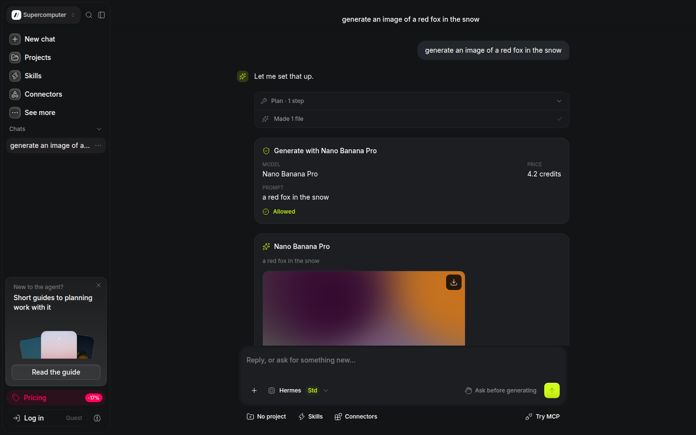

# Parallax

> **Read this, skip the rest.** Parallax is a media studio with an agent chat. One web app on
> Node 22.13+, one SQLite file, no keys needed to click through everything.
>
> ```bash
> npm ci && PARALLAX_DEMO_SEED=1 npm run dev      # then open http://localhost:3000
> ```
>
> Three ways the chat (`/supercomputer`) can answer:
>
> | Engine | Answers | Turn it on |
> |---|---|---|
> | Stand-in | a scripted assistant, spends nothing | nothing — it is the default |
> | Built-in | Parallax's own loop, on an Anthropic key | `SUPER_MODE=live` + `ANTHROPIC_API_KEY` |
> | Ariadne | your own `ariadne --serve`, with Parallax's tools over MCP | `SUPER_ENGINE=ariadne` |
>
> Run the built app for real: `npm run build && deploy/start.sh mock` (`deploy/stop.sh` to stop).
> Drop `mock` to spend credits through treg.to. Read [`SECURITY.md`](SECURITY.md) before the
> internet. For how the whole thing is used, what each page does and every address to reach,
> read [`docs/using-parallax.md`](docs/using-parallax.md).

**An open-source AI image, video and audio studio, with an agent chat you can run on your own Ariadne agent.**

One web app: studios for pictures, video, voices and music, tools built on top of them, a
community feed, a library, credits, an API for developers, and Supercomputer, an agent that
plans and makes things for you.


It runs with `npm run dev` and nothing else installed. The database is one SQLite file, and
without a provider key every model answers with a built-in sample file, so you can click
through the whole product for free.

| | |
|---|---|
|  |  |

## Quick start

You need Node.js 22.13 or newer (the app uses Node's built-in SQLite).

```bash
git clone https://github.com/itsXactlY/parallax.git
cd parallax
npm ci
PARALLAX_DEMO_SEED=1 npm run dev
```

Open http://localhost:3000. You can try it as a guest with a few credits. Signing up keeps
what you made as a guest.

`PARALLAX_DEMO_SEED=1` fills a new install with four house accounts and about sixty published
pictures. Every one was made with Parallax, and each post carries the prompt that made it, so
Recreate works on all of them. Nobody can sign in as the demo accounts. Leave the variable
out for an empty feed.

## Real generations

Models are reached through one gateway, [treg.to](https://treg.to). Copy `.env.example` to
`.env.local` and set `TREG_TOKEN`. The app then runs in live mode: 39 image, video, voice and
music models, each with its own controls and an exact price shown before you press Generate.

`TREG_DAILY_BUDGET_USD` stops paid requests once that much was spent in 24 hours. Keep it low
while you try things out.

## Supercomputer, on an Ariadne agent, on Orgo

Supercomputer is the agent chat at `/supercomputer`. It can run on three things:

| Engine | What answers | Needs |
|---|---|---|
| Stand-in (default) | A scripted assistant, so the screens work with no keys | Nothing |
| Built-in | Parallax runs the agent loop itself | `SUPER_MODE=live` and a model key |
| **Ariadne** | Your own Ariadne agent (`ariadne --serve`) runs the conversation | An Ariadne agent, for example on an [Orgo](https://www.orgo.ai) computer |

With the Ariadne engine, the agent does the thinking and Parallax gives it the studio's tools
over MCP. When the agent wants a picture, the member gets an approval card with the price and
pays with their own credits. The generation key never leaves Parallax.



*The chat above ran in the test setup: a stand-in agent and a sample picture.*

**Set it up: [`docs/ariadne-on-orgo.md`](docs/ariadne-on-orgo.md).** It is a step-by-step guide:
turn on the agent's API server, make two secrets, join the machines, add one entry to the
agent's config, start Parallax. It also lists what to build next.

Two things to know before you start:

- The engine is tested end to end against a stand-in agent (`tests/super_ariadne.py`) and
  against a live `ariadne --serve` on one machine. The lane config parses, the MCP handshake
  completes, and a real Ask-mode turn ran the whole chain: `list_models`, two question cards
  answered by the member, `get_model`, an approval card at 4200 credits, `generate_media`, a
  succeeded result card with a library asset, and `remember`. The **remote** pairing
  (`deploy/tunnel.sh`, two machines) has not been run yet.
- The agent's own tools (shell, files, memory) are **not** behind Parallax's approval cards.
  Do not point a public Parallax at a personal agent. The guide explains the safe setup.

**Same machine, in one block.** Parallax and the agent on one host, one serve per chat:

```bash
npm run build
mkdir -p deploy/run/engine run/engine-home && chmod 700 deploy/run/engine
( umask 077
  openssl rand -hex 32 > deploy/run/engine/engine.token   # what the agent shows Parallax
  openssl rand -hex 32 > deploy/run/engine/ariadne.key    # what Parallax shows the agent
  echo "$PWD/run/engine-home" > deploy/run/engine/home.txt
  echo "$(command -v ariadne)" > deploy/run/engine/bin.txt
  echo 8643 > deploy/run/engine/port_base.txt
)
cp ~/ariadne/config.yaml run/engine-home/config.yaml       # the home every lane is built from
python3 deploy/add-parallax-to-ariadne.py \
  --config run/engine-home/config.yaml \
  --token-file deploy/run/engine/engine.token \
  --url http://127.0.0.1:3000/api/super/mcp
deploy/start.sh mock        # last line ends: chat engine: Ariadne (Ariadne, one serve per chat ...)
```

Nothing here opens a port to the internet: lanes bind `127.0.0.1:8643+N`, Parallax answers on
3000. The agent reads `config.yaml` once at boot, so a lane picks up an edit only when it is
closed and reopened (`ARIADNE_LANE_IDLE_MIN`, or delete the chat).

## What is in it

| Page | What it does |
|---|---|
| `/` and `/explore` | Home and the public feed |
| `/image`, `/video`, `/audio` | The three studios: pick a model, set its controls, generate |
| `/remix` | Restyle or move a picture or clip you already have |
| `/cinema` | Plan a film shot by shot and generate the shots as a batch |
| `/shorts` | Turn one idea into a short vertical video |
| `/apps` | One-purpose tools built on the models |
| `/ads` | Product ad campaigns with rounds and winners |
| `/canvas` | An open board for laying out pictures and notes (kept in the browser) |
| `/horizon` | A preview of what comes next: long-form video from one brief |
| `/guide` | How Parallax works: credits, studios and writing prompts |
| `/supercomputer` | An agent chat that can use a cloud computer and connected apps |
| `/community`, `/u/<handle>`, `/contests` | Posts, profiles, likes, saves, comments, follows |
| `/library` | Everything you made or uploaded, with folders and favourites |
| `/pricing`, `/wallet`, `/settings`, `/notifications` | Plans, credits and your account |
| `/developer`, `/mcp` | API keys, webhooks, usage, and the MCP server for agents |

## What is not real yet

- **Payments.** There is no payment processor. The top-up button adds credits for free and
  says so. Close it with `PARALLAX_DEMO_BILLING=off`.
- **Supercomputer's live mode.** `SUPER_MODE=live` can start cloud computers and connect
  outside apps, and both can cost money. It has had far less testing than the studios.
- **The Ariadne engine on two machines.** Proven against a live agent on one machine; the
  remote tunnel (`deploy/tunnel.sh`) has not been run on a real pair. See above.
- **Canvas** boards live in the browser only. **Horizon** is a preview page.
- **The offer on the home page** (the `LAUNCH-WEEK` code and the discount badge) is sample
  marketing. Change it (search the code for `LAUNCH`) before you run this for anyone.

Each page in `docs/api/` ends with an "Open improvements" list. Those are good first changes.

## Settings

Everything is optional. Put them in `.env.local`.

| Variable | What it does |
|---|---|
| `TREG_TOKEN` | The gateway key. Without it the app runs in mock mode |
| `TREG_MODE` | Force `mock` or `live` |
| `TREG_DAILY_BUDGET_USD` | Stop paid requests after this many dollars in 24 hours |
| `PARALLAX_DATA_DIR` | Where the database and files live. Default `./data` |
| `PARALLAX_DEMO_SEED` | `1` adds the demo accounts and posts to a new data folder |
| `PARALLAX_DEMO_BILLING` | `off` closes the free top-up button |
| `PARALLAX_ORIGIN` | The public address of the app when it runs behind a proxy or a public link, for example `https://parallax.example.com`. The server writes its links with it and accepts requests from pages at that address |
| `COOKIE_SECURE` | `1` when serving over https |
| `SUPER_MODE` | `live` lets Supercomputer use the three keys below |
| `ANTHROPIC_API_KEY`, `ORGO_API_KEY`, `COMPOSIO_API_KEY` | The agent's model, its cloud computer, and its app connections |
| `SUPER_ENGINE` | `ariadne` runs the Supercomputer chat on an Ariadne agent instead of the built-in loop |
| `ARIADNE_URL`, `ARIADNE_API_KEY_FILE`, `SUPER_ENGINE_TOKEN_FILE`, `SUPER_ENGINE_NAME` | Where the agent's serve is, its key, the token it uses to call Parallax's tools, and the name members see |
| `ARIADNE_PER_CHAT`, `ARIADNE_HOME`, `ARIADNE_BIN` | `1` starts one `ariadne --serve` per chat instead of dialing one shared endpoint, because one serve holds one conversation. Each lane then gets `lanes/<chat-id>/` under `ARIADNE_HOME` — its own config, tape and log — built from that home's `config.yaml`; `ARIADNE_BIN` is the binary it runs from |
| `ARIADNE_PORT_BASE`, `ARIADNE_LANE_IDLE_MIN`, `ARIADNE_MAX_LANES` | first loopback port a lane binds (8643), quiet minutes before a lane closes (20), how many lanes are open at once (8, oldest first) |
| `ARIADNE_DISABLE_TOOLS` | Ariadne's own tools left out of a lane. Default drops its shell, files and delegation |
| `ARIADNE_MODEL`, `ARIADNE_MCP_NAME` | the name in the model pill, and the name of Parallax's entry in the agent's `mcp_servers` (`parallax`) |
| `SUPER_TURN_MS` | how long one turn may run (300000 ms). Every call to the engine, and every wait for a render, is bounded by it. A locally served model is slow, so raise it: four steps can pass five minutes |

## Where to reach

| Address | What is behind it | Who may reach it |
|---|---|---|
| `http://localhost:3000` | the app: pages, `/api/v1`, `/api/mcp`, `/api/super/mcp` | you, or whoever you expose |
| `GET /api/super/config` | which engine is in charge (`engine.id`), the model pill, `services.llm/computer/connectors`, and the limits (steps, turn seconds, message length) | a signed-in member |
| `GET /api/super/events` | Server-Sent Events for every chat of this member | a signed-in member, with the session cookie |
| `POST /api/super/mcp` | Parallax's door for the agent | only a caller holding the engine token; never on an unauthenticated page |
| `POST /api/mcp` | the developer MCP: nine tools, three resources | a developer's API key |
| `GET /api/v1/*` | the REST API: models, quotes, jobs, library, credits | a developer's API key |
| `http://127.0.0.1:8643+N` | one lane's `ariadne --serve` | only Parallax, with the lane's bearer token; never routed past loopback |
| `http://127.0.0.1:8642` | the shared agent endpoint, `ARIADNE_PER_CHAT=0` | you |

### Worked examples

```bash
# stand-in, no keys, no spend: send a message, watch the rows
npm ci && PARALLAX_DEMO_SEED=1 npm run dev

# real generations: sample files become real files, and the agent's tool calls cost credits
cp .env.example .env.local                    # then set the four keys below
# TREG_TOKEN=...  TREG_DAILY_BUDGET_USD=2  SUPER_MODE=live  SUPER_ENGINE=ariadne
npm run build && deploy/start.sh

# the agent on this machine: see the one-block setup above, then send
# "Make me a poster of a lighthouse at dusk." in /supercomputer

# One conversation end to end, with the stand-in engine: guest, chat, message, poll, get the file
J=/tmp/p.json; C=/tmp/p.jar
curl -c $C -b $C -X POST localhost:3000/api/auth/guest -o $J          # a throwaway account with credits
curl -b $C -X POST localhost:3000/api/super/chats -d '{}' -o $J       # a conversation
CHAT=$(python3 -c "import json;print(json.load(open('$J'))['chat']['id'])")
curl -b $C -X POST localhost:3000/api/super/chats/$CHAT/messages \
  -d '{"text":"a 512x512 image of a fox in snow","mode":"auto","model":"auto"}' -o $J
echo '{"rows":[]}' > $J
REV=0
until python3 -c "import json,sys;d=json.load(open('$J'));sys.exit(0 if any(r['kind']=='card' and r['body'].get('card')=='result' and r['body'].get('status')=='succeeded' for r in d['rows']) else 1)"; do
  curl -s -b $C "localhost:3000/api/super/chats/$CHAT/rows?after=$REV" -o $J
  REV=$(python3 -c "import json;print(json.load(open('$J'))['rev'])")
  sleep 5
done
curl -b $C "localhost:3000/api/assets?limit=5" -o $J                  # the asset is filed once the result card lands
curl -b $C -o fox.png localhost:3000/api/assets/<asset-id>/file       # bytes, not JSON

# What an engine sees on Parallax's MCP door. Tool names are bare: exactly what tools/list returns.
curl -X POST localhost:3000/api/super/mcp \
  -H "Authorization: Bearer $(cat deploy/run/engine/engine.token)" -H 'Content-Type: application/json' \
  -d '{"jsonrpc":"2.0","id":1,"method":"initialize","params":{"protocolVersion":"2025-06-18","capabilities":{}}}'
curl -X POST localhost:3000/api/super/mcp \
  -H "Authorization: Bearer $(cat deploy/run/engine/engine.token)" -H 'Content-Type: application/json' \
  -d '{"jsonrpc":"2.0","id":2,"method":"tools/list"}'
# tools/call needs a turn key the engine minted for its own turn; Parallax re-verifies it on arrival,
# so a call cannot be replayed or forged. The contract is docs/api/super.md, "the engine's tool server".
```

`docs/using-parallax.md` walks through all of these with the exact requests and the real output.

## Run it for real

```bash
npm ci && npm run build
deploy/start.sh mock      # sample files. Drop "mock" for real generations.
deploy/stop.sh
```

`deploy/start.sh` runs the built app in the background with a clean environment and keeps its
data and log in `deploy/run/`. Read [`SECURITY.md`](SECURITY.md) before you put it on the
internet.

## Checks and tests

```bash
npm run typecheck
npm run lint
npm run check:registry     # every model, every combination of controls, has an exact price
npm run build
npm test
```

`npm test` starts the built app in mock mode on an empty data folder for each test file, and
removes every key from its environment, so a test can never spend money. The `.py` files test
the API (Python 3, standard library only). The `.mjs` files are browser walk-throughs; they
need Chrome and save their screenshots in `ui-shots/`. Set `UI_SIZE="390 844"` to walk through
at phone size. To run a few: `python3 tests/run.py tests/core_e2e.py tests/ui/home.mjs`.

## Where things are

| Path | What it is |
|---|---|
| `src/app/` | Pages and API routes |
| `src/server/` | Database, accounts, credits, jobs, the worker, files, the gateway |
| `src/registry/` | Every model: its controls, inputs, price and request |
| `src/components/`, `src/ui/`, `src/content/` | Screens, shared controls, and all wording |
| `migrations/` | The database tables, applied in order on first start |
| `seed/demo/` | The demo content |
| `docs/api/` | The API reference, one page per feature |
| `docs/ariadne-on-orgo.md` | Running Supercomputer on an Ariadne agent |
| `docs/using-parallax.md` | how the app is used: every route, every endpoint, worked examples |
| `deploy/add-parallax-to-ariadne.py` | adds Parallax's MCP entry to an Ariadne `config.yaml` |
| `docs/ui/README.md`, `CONTRIBUTING.md` | How to build a screen, and how to build a feature |
| `deploy/` | Scripts to run the built app in the background, and to join it to an agent |

## How this was built

Parallax was built in a day by a swarm of coding agents working from a written product spec
and a design system, each on its own cloud computer, with one orchestrator merging the work.
The API notes in `docs/api/` and the rules in `CONTRIBUTING.md` and `docs/ui/README.md` are
the same ones the agents worked from.

## Contributing

Read [`CONTRIBUTING.md`](CONTRIBUTING.md). Agents: read [`AGENTS.md`](AGENTS.md) first.

## Licence

[MIT](LICENSE).

Parallax is an independent project. It is not affiliated with, endorsed by, or sponsored by
any company whose models, products or services it mentions or connects to. Model and product
names belong to their owners. The pictures in this repository were made with Parallax.
